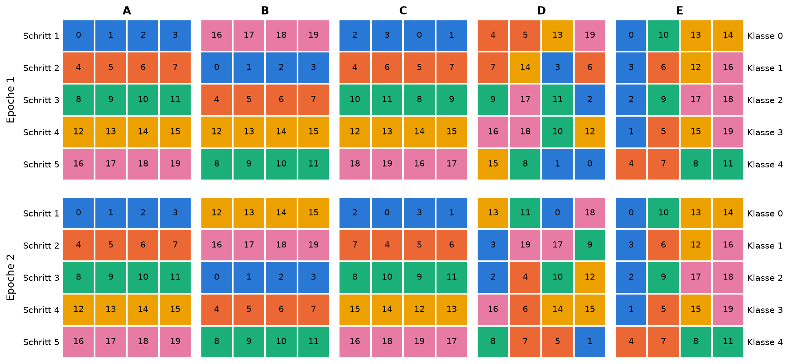
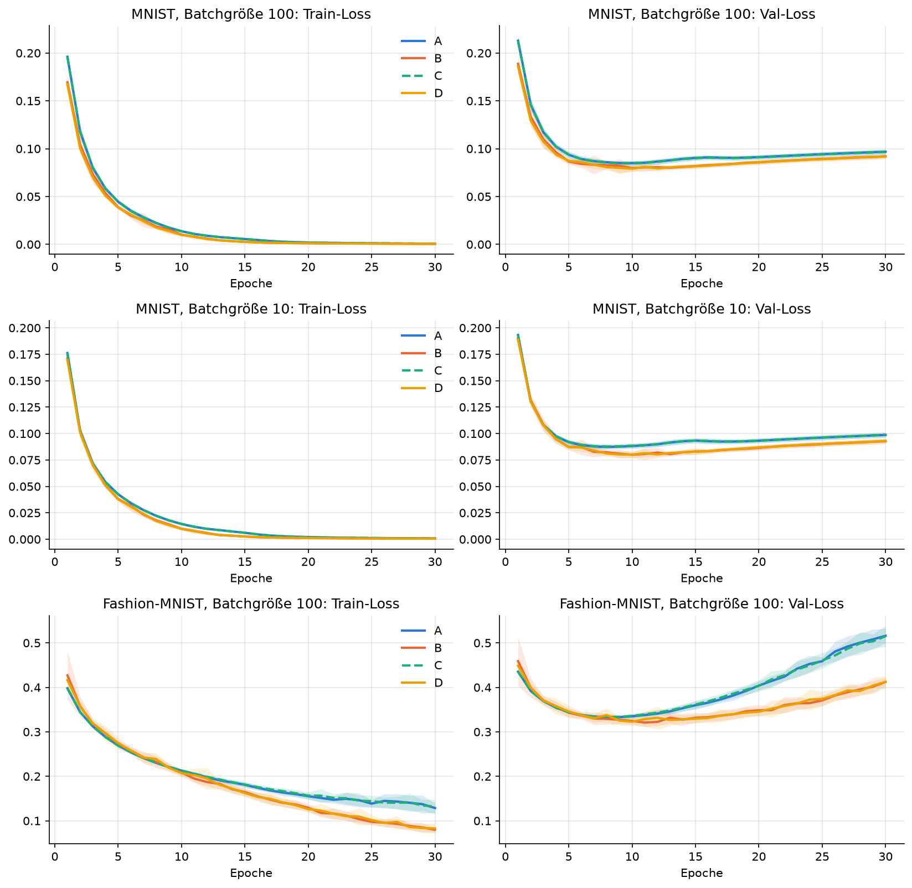
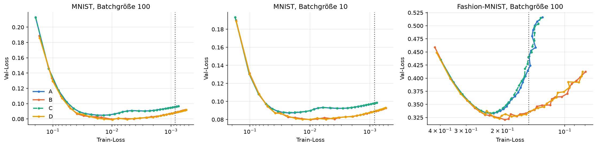
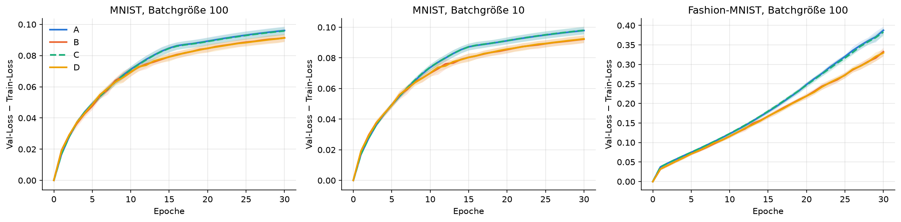
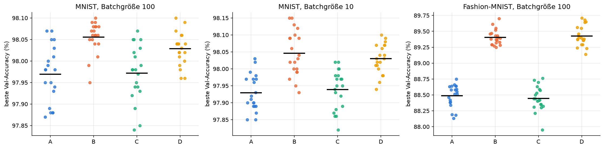
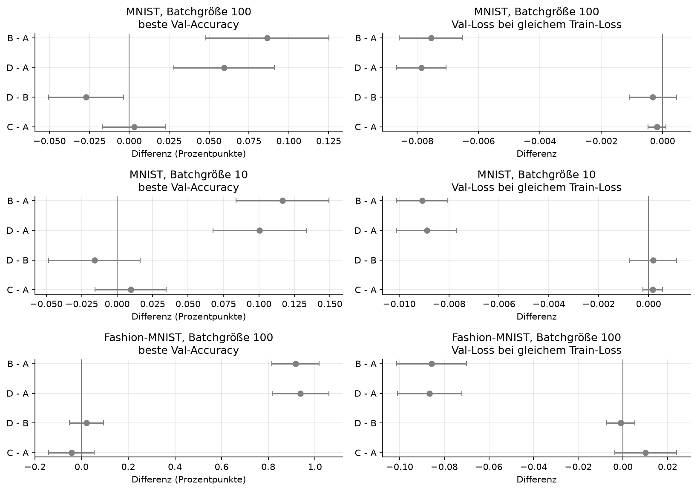
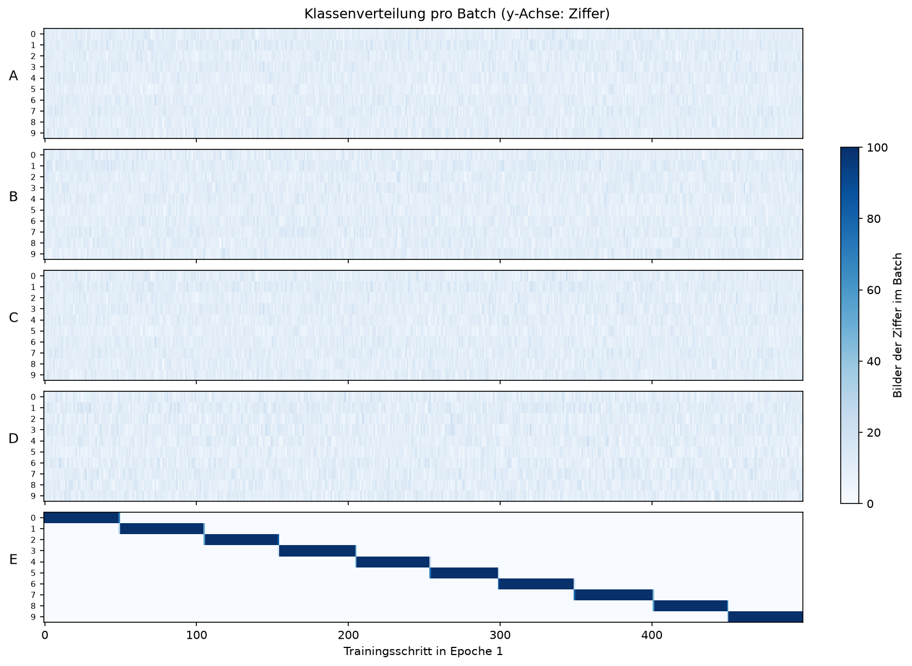
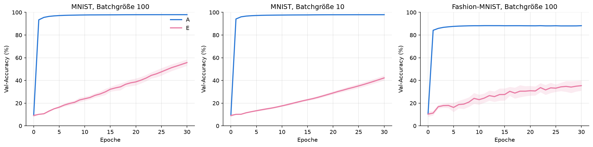

# Does Shuffling Help Models Generalize?


[](LICENSE)

> Oft werden in einem ML-Model vor jeder Epoche die Daten geshuffelt. Aber hilft das dem Modell tatsächlich beim Generalisieren? Diese Frage habe ich mir heute in einer Uni-Vorlesung gestellt.

Ein kleines, bewusst simples Experiment dazu: ein MLP ohne jede Regularisierung, fünf Arten, die Daten (nicht) zu shuffeln, drei Experimente, 20 Seeds pro Variante. Macht **300 Trainingsläufe**, alle deterministisch und mit einem Befehl reproduzierbar.

## TL;DR

| | MNIST, Batch 100 | MNIST, Batch 10 | Fashion-MNIST, Batch 100 |
|---|---|---|---|
| beste Val-Accuracy ohne Shuffling (A) | 97,97 % | 97,93 % | 88,49 % |
| beste Val-Accuracy mit Shuffling (B / D) | 98,06 % / 98,03 % | 98,05 % / 98,03 % | **89,40 % / 89,43 %** |
| Val-Loss bei gleichem Train-Loss, B/D gegenüber A | -8 % | -9 % | **-20 %** |
| Seeds, in denen A beim Val-Loss besser ist | 0 / 20 | 0 / 20 | 0 / 20 |

- **Ja, Shuffling hilft beim Generalisieren.** Bei gleich guter Anpassung an die Trainingsdaten schneiden die geshuffelten Varianten in jedem einzelnen Seed besser ab. Auf MNIST ist der Effekt klein, auf dem schwereren Fashion-MNIST deutlich.
- **Es zählt die Reihenfolge der Schritte, nicht neue Batches.** Nur die Reihenfolge der festen Batches zu shuffeln (B) bringt genauso viel wie komplett neu zu shuffeln (D). Hatte ich ehrlich gesagt anders erwartet.
- **Eine schlechte feste Reihenfolge ist fatal.** Nach Klassen sortiert (E) kommt das Netz nicht über 39-56 % Accuracy hinaus.

Details und Plots: [Ergebnisse](#ergebnisse).

---

## Inhalt

- [Motivation](#motivation)
- [Was heißt hier Shuffling?](#was-heißt-hier-shuffling)
- [Deploy it yourself](#deploy-it-yourself)
- [Methodik und Implementierung](#methodik-und-implementierung)
- [Ergebnisse](#ergebnisse)
- [Grenzen und Ideen](#grenzen-und-ideen)
- [Contributing und Lizenz](#contributing-und-lizenz)

---

## Motivation

In der Uni kam die Frage auf, ob Shuffling eigentlich auch ein Werkzeug der Regularisierung ist, in einer Reihe mit Dropout, Weight Decay, Early Stopping und Co. Man kann beides argumentieren: Vielleicht sorgt Shuffling nur dafür, dass die Batches repräsentativ sind. Oder das zusätzliche Rauschen beim Lernen hält das Modell tatsächlich davon ab, auf die Trainingsdaten zu overfitten.

Mein Professor meinte, ich solle das doch einfach selbst ausprobieren und ihm dann berichten. Den Anstoß habe ich ernst genommen :) 

Das hier ist dabei herausgekommen.

> [!NOTE]
> Das ist ein kleines Projekt, keine wissenschaftliche Arbeit. Ich habe versucht, sauber zu arbeiten (gepaartes Design, feste Seeds, Determinismus), aber das Setup ist bewusst klein und einfach gehalten, siehe [Grenzen](#grenzen-und-ideen). Wenn dir ein Fehler auffällt oder du eine Idee hast, was man besser oder zusätzlich testen sollte: Issues, Forks und Pull Requests sind sehr willkommen, siehe [CONTRIBUTING.md](CONTRIBUTING.md).

---

## Was heißt hier Shuffling?

Ein Netz wird mit Mini-Batch-SGD trainiert: Die Trainingsdaten werden in Batches geschnitten, und für jeden Batch macht das Netz einen Gradientenschritt. Der Gradient eines Batches ist der **Mittelwert** über seine Datenpunkte. Shuffling kann also nur zwei Dinge ändern:

1. **welche** Datenpunkte zusammen in einem Batch landen (Zusammensetzung) und
2. **in welcher Reihenfolge** die Batches drankommen.

Die Reihenfolge innerhalb eines Batches ist für den Gradienten egal. Daraus ergeben sich fünf Varianten:

| Variante | Was passiert vor jeder Epoche | Reihenfolge der Batches | Reihenfolge im Batch | Funktion |
|---|---|---|---|---|
| **A** | nichts, immer die Original-Reihenfolge | fest | fest | [`no_shuffle`](src/batch_shuffling_regularization/shuffling.py) |
| **B** | die festen Batches kommen in neuer Reihenfolge | neu | fest | [`shuffle_batch_order`](src/batch_shuffling_regularization/shuffling.py) |
| **C** | innerhalb jedes Batches wird geshuffelt | fest | neu | [`shuffle_within_batches`](src/batch_shuffling_regularization/shuffling.py) |
| **D** | alles neu shuffeln, dann neu in Batches schneiden (Standard; siehe bspw. Model.fit(shuffle=True) in Keras) | neu | neu | [`full_reshuffle`](src/batch_shuffling_regularization/shuffling.py) |
| **E** | wie A, aber die Daten sind nach Klasse sortiert | fest | fest | [`sort_train_by_class`](src/batch_shuffling_regularization/data.py) |

**C** ist mathematisch dasselbe wie A und dient als Kontrolle: Unterscheidet sich C von A, misst das Setup Rauschen statt Effekte. **E** ist der Extremfall einer schlechten festen Reihenfolge.

### Visualisierung an einem Mini-Datensatz

20 Datenpunkte, Batchgröße 4, also 5 Schritte pro Epoche. Jede Zeile ist ein Trainingsschritt, die Zahl ist der Index des Datenpunkts, die Farbe zeigt, zu welchem Batch er ursprünglich gehört. Oben Epoche 1, unten Epoche 2:



- **A** ist in beiden Epochen identisch.
- **B** behält die einfarbigen Zeilen (Batches), nur die Reihenfolge der Zeilen ändert sich.
- **C** sieht aus wie A, nur die Zahlen innerhalb einer Zeile tauschen die Plätze.
- **D** würfelt die Farben durcheinander: Jeder Batch ist neu zusammengesetzt, und zwar in jeder Epoche anders.
- **E** sortiert nach Klasse: Jeder Batch enthält nur eine Klasse, und die Reihenfolge ist in jeder Epoche dieselbe.

Erzeugt in [`02_shuffling_variants.ipynb`](notebooks/02_shuffling_variants.ipynb). Dort wird die Implementierung auch auf den echten Daten geprüft (jede Epoche ist eine Permutation, B erhält alle Batches, D keinen, …).

---

## Deploy it yourself

### 1. Clone

```bash
git clone https://github.com/dariandieck/ml-shuffling-regularization.git
cd ml-shuffling-regularization
```

### 2. Umgebung aufsetzen

**Mit [uv](https://docs.astral.sh/uv/getting-started/installation/) (empfohlen):**

```bash
uv sync
```

Das legt `.venv/` mit Python 3.12 an und installiert alle Dependencies, inklusive PyTorch mit CUDA 12.8. Python muss nicht vorinstalliert sein.

**Mit pip** (setzt Python 3.12 voraus):

```bash
python -m venv .venv
source .venv/bin/activate        # Windows: .venv\Scripts\activate
pip install -r requirements.txt
```

### 3. GPU und CUDA (optional)

Unter Windows und Linux werden die CUDA-12.8-Builds von PyTorch installiert. Dafür reicht ein aktueller NVIDIA-Treiber. Ein CUDA Toolkit ist **nicht** nötig. Smoke-Test, ob die GPU erkannt wird:

```bash
uv run python -c "import torch; print(torch.cuda.is_available())"
```

Ohne GPU läuft alles automatisch auf der CPU ([`get_device`](src/batch_shuffling_regularization/training.py)). Das funktioniert, ist aber langsamer, obviously. Unter macOS wird die normale PyTorch-Version von PyPI installiert und auf der CPU gerechnet.

### 4. Pipeline

Jupyter braucht es dafür nicht. Ein Befehl reicht ([`__main__.py`](src/batch_shuffling_regularization/__main__.py)):

```bash
uv run shuffling all
```

| Befehl | Was passiert |
|---|---|
| `shuffling run [experimente] [--shard i/n]` | trainiert alle Läufe, die noch nicht in `results/` liegen |
| `shuffling analyse` | führt [`04_analysis.ipynb`](notebooks/04_analysis.ipynb) aus und schreibt die Plots nach `figures/` |
| `shuffling all` | beides nacheinander |

Wer kein Bock hat die Modelle selber zu trainieren: Es liegen alle 300 runs als CSV in `results/`. Wer ein Experiment selbst neu rechnen will, löscht einfach `results/<experiment>/runs/`.

Laufzeiten auf meiner RTX 5070 Ti (100 Läufe pro Experiment):

| Experiment | pro Lauf | gesamt |
|---|---|---|
| `mnist_bs100` | ca. 11 s | ca. 20 min |
| `mnist_bs10` | ca. 105 s | ca. 3 h |
| `fashion_bs100` | ca. 12 s | ca. 20 min |

Bei `mnist_bs10` ist nicht die Rechenleistung der Engpass, sondern der Overhead pro Schritt. Die Seeds lassen sich auch über mehrere Sessions verteilen:

1. `uv run shuffling run mnist_bs10 --shard 0/4`
2. `uv run shuffling run mnist_bs10 --shard 1/4`
3. `uv run shuffling run mnist_bs10 --shard 2/4`
4. `uv run shuffling run mnist_bs10 --shard 3/4`


### 5. Notebooks (optional)

Die Notebooks erzählen das Ganze Schritt für Schritt, mit allen Ausgaben. Öffnen lassen sie sich in VS Code oder PyCharm mit `.venv` als Kernel oder mit `uv run --with jupyter jupyter lab`.

| Notebook | Inhalt |
|---|---|
| [`01_data_and_probe`](notebooks/01_data_and_probe.ipynb) | Daten, Modell, ein erster Probelauf, Determinismus-Check |
| [`02_shuffling_variants`](notebooks/02_shuffling_variants.ipynb) | die Varianten visualisiert und auf echten Daten geprüft, Kontrolllauf A vs. C |
| [`03_run_experiment`](notebooks/03_run_experiment.ipynb) | Konfiguration der drei Experimente und Training |
| [`04_analysis`](notebooks/04_analysis.ipynb) | die komplette Auswertung mit Interpretation |

---

## Methodik und Implementierung

### Tool-Stack

| Tool | Kommentar | 
|---|--------------------------------------------------------------------------------------------------------------------------------------------------------------------------------------------------------------------------------------------------------------------------------------------------------------------------------------------------------------------------------------------------------------------------------------------------------|
| **Python 3.12** | stabil und support für alle Dependencies                                                                                                                                                                                                                                                                                                                                                                                                               |
| **PyTorch 2.11 + CUDA 12.8** | 300 Läufe auf der CPU wären keine Option gewesen und ich wollte mal meine tolle RTX 5070 Ti Stresstesten (Der Preis muss sich ja auch lohnen). TensorFlow unterstützt die GPU unter nativem Windows seit Version 2.11 nicht mehr, PyTorch schon. CUDA 12.8 ist nötig, weil ältere Builds die Blackwell-GPUs (RTX 50xx) nicht kennen. Außerdem ist die Trainingsschleife in PyTorch verbos explizit. Bei Keras versteckt sich das hinter `Model.fit()`. |
| **uv** | schnell, und `uv.lock` pinnt alle Versionen                                                                                                                                                                                                                                                                                                                                                                                                            |
| **pandas, SciPy, matplotlib** | Ergebnisse als Tabellen, Statistik-Tests, Plots. Standard.                                                                                                                                                                                                                                                                                                                                                                                             |
| **Skripte + Notebooks** | Die Logik liegt in normalen Python-Modulen (testbar, importierbar, per CLI ausführbar), die Notebooks sind nur die Präsentationsschicht darüber.                                                                                                                                                                                                                                                                                                       |

### Projektstruktur

```
src/batch_shuffling_regularization/
    data.py          MNIST / Fashion-MNIST laden, Split, Normalisierung, Sortierung für E
    model.py         das MLP
    shuffling.py     die Batch-Reihenfolgen A-D
    training.py      Trainingsschleife, Metriken, Determinismus
    experiment.py    die drei Experimente, Läufe speichern und laden
    analysis.py      Kennzahlen pro Lauf, gepaarte Statistik
    __main__.py      die CLI (shuffling run / analyse / all)
notebooks/           01-04, siehe oben
results/             eine CSV pro Lauf: results/<experiment>/runs/<variante>_seed<n>.csv
figures/             die Plots aus Notebook 02 und 04
```

### Daten

| Split | Größe | Herkunft |
|---|---|---|
| Train | 50.000 | Original-Trainingsset ohne die Val-Bilder|
| Validation | 10.000 | zufällig aus dem Original-Trainingsset gezogen (fester Seed 0) |
| Test | 10.000 | Original-Testset |

- **Reihenfolge** Die Original-Reihenfolge von MNIST ist übrigens bereits zufällig. A ist also eine feste, aber zufällige Reihenfolge ([`load_dataset`](src/batch_shuffling_regularization/data.py)).
- **Warum ein eigener Validation-Split?** Die beste Epoche wird anhand von Val gewählt. Test bleibt dadurch unberührt und liefert eine unverzerrte Schätzung.
- Der ganze Datensatz liegt auf der GPU, Batches sind nur Index-Tensoren. Ein DataLoader wäre bei diesen Datenmengen reiner Overhead.

### Modell und Training

| | Wert                                                                                  | Kommentar                                                                                                           |                                                                                                         
|-----------------|---------------------------------------------------------------------------------------|---------------------------------------------------------------------------------------------------------------------|
| Modell          | MLP 784-256-256-10, ReLU ([`build_mlp`](src/batch_shuffling_regularization/model.py)) | klein und schnell, aber groß genug, um deutlich zu overfitten                                                       |
| Regularisierung | keine                                                                                 | Jede andere Regularisierung würde den Effekt des Shufflings überlagern.                                             |
| Optimierer      | plain SGD, ohne Momentum                                                              | Momentum glättet den Optimierungspfad und könnte Reihenfolge-Effekte verwischen. Plain SGD ist der direkteste Test. |
| Lernrate        | 0,1. konstant                                                                         | (bei Batchgröße 10: 0,01)                                                                                           |
| Epochen         | 30                                                                                    | Der Val-Loss erreicht sein Minimum nach 8-12 Epochen. Mit 30 Epochen sieht man also auch die Overfitting-Phase.     |
| Loss            | Cross-Entropy                                                                         | Klassifikationsproblem                                                                                              |

Die Trainingsschleife ([`train`](src/batch_shuffling_regularization/training.py)) ist absichtlich minimal. Die Variante steckt einzig in `batch_order`:

```python
for epoch in range(1, cfg.epochs + 1):
    model.train()
    for idx in batch_order(len(data.train), cfg.batch_size, gen).to(device):
        loss = F.cross_entropy(model(data.train.x[idx]), data.train.y[idx])
        optimizer.zero_grad()
        loss.backward()
        optimizer.step()
    history.append(epoch_metrics(model, data, epoch))
```

Jede Variante ist eine Funktion mit derselben Signatur, die für eine Epoche eine Index-Matrix `(n_batches, batch_size)` zurückgibt ([`shuffling.py`](src/batch_shuffling_regularization/shuffling.py)):

```python
def shuffle_batch_order(n, batch_size, gen):      # B
    batches = no_shuffle(n, batch_size, gen)
    return batches[torch.randperm(batches.shape[0], generator=gen)]

def full_reshuffle(n, batch_size, gen):           # D
    return torch.randperm(n, generator=gen).reshape(-1, batch_size)
```

Die Metriken werden am Ende jeder Epoche **auf den kompletten Splits** berechnet, nicht als laufender Mittelwert über die Batches. Der laufende Mittelwert vermischt Modellstände aus der ganzen Epoche und wäre mit dem Val-Loss nicht vergleichbar.

### Experimente

Drei Experimente, jedes trainiert alle fünf Varianten mit 20 Seeds ([`EXPERIMENTS`](src/batch_shuffling_regularization/experiment.py)). Experiment 2 und 3 ändern gegenüber Experiment 1 jeweils genau eine Sache, damit sich ein Unterschied eindeutig zuordnen lässt:

| Experiment | Datensatz | BS  | LR | Kommentar                                                                                                                                                                                                                                                                                                                                       |
|---|---|-----|---|-------------------------------------------------------------------------------------------------------------------------------------------------------------------------------------------------------------------------------------------------------------------------------------------------------------------------------------------------|
| `mnist_bs100` | MNIST | 100 | 0,1 | Referenz                                                                                                                                                                                                                                                                                                                                     |
| `mnist_bs10` | MNIST | 10  | 0,01 | Bei Batchgröße 100 enthält jeder Batch ohnehin alle 10 Ziffern, die festen Batches von B sind also schon repräsentativ. Bei Batchgröße 10 nicht mehr. Spielt die Zusammensetzung der Batches eine Rolle, sollte sich D hier von B absetzen. Die Lernrate wird mit der Batchgröße skaliert, damit der Fortschritt pro Epoche vergleichbar bleibt. |
| `fashion_bs100` | Fashion-MNIST | 100 | 0,1 | schwerer zu lernen, das Netz overfittet viel stärker. Ein Regularisierungseffekt hat hier mehr Raum sichtbar zu werden.                                                                                                                                                                                                                         |

### Seeds und gepaartes Design

- **20 Seeds pro Variante.** Allein durch die zufällige Initialisierung schwankt die Accuracy um etwa 0,05-0,2 Prozentpunkte. Mit nur einem Lauf pro Variante wäre das Ergebnis Zufall.
- **Gepaart:** Derselbe Seed bedeutet dieselben Startgewichte für alle Varianten ([`run_experiment`](src/batch_shuffling_regularization/experiment.py)). Verglichen wird dann pro Seed die Differenz zwischen zwei Varianten. So fällt das Rauschen der Initialisierung heraus, und auch kleine Effekte werden sichtbar.
- Die Reihenfolge der Daten hat einen eigenen `torch.Generator`. Shuffling und Initialisierung kommen sich so beim Zufall nicht in die Quere.

### Metriken

Berechnet pro Lauf in [`run_metrics`](src/batch_shuffling_regularization/analysis.py):

| Kennzahl | Wofür |
|---|---|
| Train- und Val-Loss pro Epoche | die Lernkurven, der Ausgangspunkt für alles andere |
| Generalization Gap (Val-Loss - Train-Loss) | wie weit Training und ungesehene Daten auseinanderliegen - die eigentliche Frage |
| **Val-Loss bei gleichem Train-Loss** | der faire Vergleich, siehe unten |
| beste Val-Accuracy und ihre Epoche | die Zahl, die in der Praxis interessiert |
| Test-Accuracy in dieser Epoche | unverzerrt, weil Test bei der Wahl der Epoche keine Rolle spielt |
| Minimum des Val-Loss und seine Epoche | wann das Overfitting einsetzt |

**Warum „Val-Loss bei gleichem Train-Loss“?** Varianten, die schneller lernen, haben in derselben Epoche einen kleineren Train-Loss. Ein Gap in einer festen Epoche vergleicht deshalb Modelle mit unterschiedlichem Trainingsstand. Fairer ist die Frage: Wenn zwei Modelle die Trainingsdaten gleich gut treffen - welches ist auf ungesehenen Daten besser? Als gemeinsames Niveau dient dafür das größte End-Train-Loss aller Läufe von A-D, das also jeder Lauf irgendwann erreicht ([`common_train_loss`](src/batch_shuffling_regularization/analysis.py)). Der Val-Loss an dieser Stelle wird zwischen den zwei benachbarten Epochen interpoliert ([`val_loss_at_train_loss`](src/batch_shuffling_regularization/analysis.py)).

### Statistik

Für jedes Paar von Varianten und jede Kennzahl wird pro Seed die Differenz gebildet ([`paired_comparison`](src/batch_shuffling_regularization/analysis.py)). Berichtet werden:

- **mittlere Differenz mit 95-%-Konfidenzintervall** (t-Verteilung): wie groß der Effekt ist und wie sicher;
- **Seeds mit Differenz > 0**: in wie vielen der 20 Paare die erste Variante vorne liegt - auch ohne Statistik-Hintergrund gut lesbar;
- **Wilcoxon-Vorzeichen-Rang-Test**: prüft, ob die Differenzen systematisch von 0 abweichen.

**Warum Wilcoxon und nicht der t-Test?** Bei nur 20 Paaren kann man sich nicht sicher sein, dass die Differenzen normalverteilt sind. Wilcoxon braucht diese Annahme nicht. 

Weil viele Vergleiche gleichzeitig laufen, ist ein einzelnes p ≈ 0,03 nicht viel wert. Als Befund zählt nur, was über mehrere Kennzahlen und Experimente hinweg konsistent ist.

### Reproduzierbarkeit und Determinismus

Auf der GPU sind manche Operationen standardmäßig nicht deterministisch. Feste Seeds allein reichen also nicht, um zweimal dasselbe Ergebnis zu bekommen. [`make_deterministic`](src/batch_shuffling_regularization/training.py) schaltet das ab:

```python
def make_deterministic() -> None:
    os.environ.setdefault("CUBLAS_WORKSPACE_CONFIG", ":4096:8")
    torch.use_deterministic_algorithms(True)
```

Zusammen mit `torch.manual_seed(seed)` für die Initialisierung ([`build_mlp`](src/batch_shuffling_regularization/model.py)), einem eigenen Generator für die Reihenfolge und dem festen Split-Seed hängt jeder Lauf nur noch von seinem Seed ab. Geprüft: Ein kompletter Neulauf von 50 Läufen ergab 50 bit-identische CSVs, auch während andere Prozesse die GPU belasteten.

Ein paar einfache Tricks für die Laufzeit: Die Daten liegen komplett auf der GPU, Batches sind nur Indizes, in der Schleife gibt es kein `.item()` (das würde GPU und CPU jedes Mal synchronisieren), und ausgewertet wird nur einmal pro Epoche. Jeder Lauf wird sofort als CSV gespeichert. Man kann also jederzeit abbrechen und später weitermachen.

---

## Ergebnisse

Die Plots stammen aus [`04_analysis.ipynb`](notebooks/04_analysis.ipynb), nur die Klassenverteilung in Abschnitt 6 aus Notebook 02. In Notebook 04 stehen auch die vollständigen Tabellen und die Interpretation pro Abschnitt. Mittelwerte und Bänder gehen über 20 Seeds, das Band ist ± eine Standardabweichung.

### 1. Lernkurven: wo sich die Varianten trennen



- A und C liegen exakt übereinander, B und D ebenso. Die Kontrolle funktioniert, und es gibt im Grunde nur zwei Gruppen: **feste Reihenfolge** (A, C) und **geshuffelte Reihenfolge** (B, D).
- Alle Varianten erreichen ihr Val-Loss-Minimum nach 8-12 Epochen. Danach steigt der Val-Loss bei A/C deutlich stärker.
- Bei Fashion-MNIST ist der Unterschied massiv: In Epoche 30 liegt der Val-Loss von A bei 0,52, der von B/D bei 0,41. Gleichzeitig fällt der Train-Loss von A in der zweiten Hälfte langsamer (0,13 gegenüber 0,08). A overfittet also stärker, **obwohl** es die Trainingsdaten schlechter trifft. Eine (ungeprüfte) Vermutung: Bei fester Reihenfolge sind die letzten Batches jeder Epoche immer dieselben und ziehen den Modellstand am Epochenende jedes Mal in dieselbe Richtung.

### 2. Val-Loss bei gleichem Train-Loss



* **Warum?:** Er nimmt die Trainingsgeschwindigkeit aus dem Vergleich heraus. Jeder Punkt ist eine Epoche, das Training läuft von links nach rechts. Liegt eine Kurve tiefer, hat diese Variante bei gleicher Anpassung an die Trainingsdaten den niedrigeren Val-Loss. Sie generalisiert also besser. Die gepunktete Linie ist das gemeinsame Niveau, an dem gemessen wird:

| Experiment | A | B | D | B, D gegenüber A |
|---|---|---|---|---|
| MNIST, Batch 100 | 0,0959 | 0,0883 | 0,0880 | **-8 %** |
| MNIST, Batch 10 | 0,0980 | 0,0889 | 0,0891 | **-9 %** |
| Fashion-MNIST, Batch 100 | 0,420 | 0,334 | 0,333 | **-20 %** |

Das ist der eigentliche Beleg für den Regularisierungseffekt: B und D sind nicht nur schneller, sie generalisieren bei gleichem Trainingsstand besser. Bei MNIST trennen sich die Kurven erst in der Overfitting-Phase. Bei Fashion-MNIST knickt die Kurve von A/C fast senkrecht nach oben. Der Val-Loss steigt weiter, während sich der Train-Loss kaum noch bewegt.

### 3. Generalization Gap über die Epochen



* Der Gap war die ursprüngliche Frage. Bis etwa Epoche 8 ist er für alle Varianten gleich, danach wächst er bei A/C schneller:

| Gap in Epoche 30 | A | B | D |
|---|---|---|---|
| MNIST, Batch 100 | 0,096 | 0,091 | 0,091 |
| MNIST, Batch 10 | 0,098 | 0,092 | 0,093 |
| Fashion-MNIST, Batch 100 | 0,387 | 0,333 | 0,330 |

> [!CAUTION]
> Ein Gap in einer festen Epoche vergleicht Modelle mit unterschiedlichem Trainingsstand. Plot 2 ist deshalb der fairere Vergleich. Wie trügerisch der Gap sein kann, zeigt Variante E weiter unten.

### 4. Beste Val-Accuracy und Streuung über die Seeds



- **MNIST:** B/D liegen 0,06-0,12 Prozentpunkte vorne. Das ist ungefähr so viel wie die Streuung über die Seeds, die Punktwolken überlappen. Sichtbar wird der Effekt erst im gepaarten Vergleich.
- **Fashion-MNIST:** +0,9 Prozentpunkte (88,5 % -> 89,4 %), etwa fünf- bis siebenmal die Streuung. Die Wolken sind komplett getrennt.
- Die Test-Accuracy in der jeweils besten Epoche zeigt dasselbe (Fashion-MNIST: 88,1 % -> 89,0 %).
- Bei Fashion-MNIST setzt das Overfitting mit Shuffling später ein: Das Val-Loss-Minimum liegt bei Epoche 11-12 statt 8.

<details>
<summary>Alle Kennzahlen pro Variante (Mittelwert ± Standardabweichung)</summary>

**MNIST, Batch 100**

| | beste Val-Acc (%) | Epoche | Test-Acc (%) | min. Val-Loss | Gap Ep. 30 | Val-Loss bei gl. Train-Loss |
|---|---|---|---|---|---|---|
| A | 97,97 ± 0,07 | 24,9 ± 4,6 | 98,02 ± 0,08 | 0,0845 ± 0,0022 | 0,0961 ± 0,0026 | 0,0959 ± 0,0025 |
| B | 98,06 ± 0,04 | 21,2 ± 4,9 | 98,12 ± 0,05 | 0,0771 ± 0,0025 | 0,0914 ± 0,0024 | 0,0883 ± 0,0020 |
| C | 97,97 ± 0,07 | 24,6 ± 4,3 | 98,02 ± 0,08 | 0,0844 ± 0,0022 | 0,0958 ± 0,0026 | 0,0957 ± 0,0026 |
| D | 98,03 ± 0,04 | 20,1 ± 5,1 | 98,08 ± 0,07 | 0,0768 ± 0,0016 | 0,0913 ± 0,0025 | 0,0880 ± 0,0024 |
| E | 55,73 ± 2,87 | 30,0 ± 0,0 | 56,13 ± 2,77 | 2,2539 ± 0,0844 | 0,0705 ± 0,0161 | |

**MNIST, Batch 10**

| | beste Val-Acc (%) | Epoche | Test-Acc (%) | min. Val-Loss | Gap Ep. 30 | Val-Loss bei gl. Train-Loss |
|---|---|---|---|---|---|---|
| A | 97,93 ± 0,05 | 26,6 ± 3,5 | 98,04 ± 0,06 | 0,0871 ± 0,0022 | 0,0979 ± 0,0024 | 0,0980 ± 0,0025 |
| B | 98,05 ± 0,07 | 21,4 ± 5,7 | 98,11 ± 0,06 | 0,0771 ± 0,0019 | 0,0922 ± 0,0025 | 0,0889 ± 0,0024 |
| C | 97,94 ± 0,06 | 25,7 ± 3,9 | 98,04 ± 0,07 | 0,0874 ± 0,0022 | 0,0980 ± 0,0025 | 0,0982 ± 0,0026 |
| D | 98,03 ± 0,04 | 21,5 ± 4,8 | 98,10 ± 0,07 | 0,0778 ± 0,0024 | 0,0925 ± 0,0025 | 0,0891 ± 0,0023 |
| E | 42,22 ± 2,17 | 30,0 ± 0,0 | 43,23 ± 2,06 | 2,3114 ± 0,0049 | 0,0712 ± 0,0104 | |

**Fashion-MNIST, Batch 100**

| | beste Val-Acc (%) | Epoche | Test-Acc (%) | min. Val-Loss | Gap Ep. 30 | Val-Loss bei gl. Train-Loss |
|---|---|---|---|---|---|---|
| A | 88,49 ± 0,17 | 20,7 ± 7,9 | 88,14 ± 0,18 | 0,3322 ± 0,0034 | 0,3874 ± 0,0099 | 0,4200 ± 0,0321 |
| B | 89,40 ± 0,12 | 21,2 ± 4,4 | 89,01 ± 0,24 | 0,3131 ± 0,0049 | 0,3326 ± 0,0108 | 0,3343 ± 0,0110 |
| C | 88,45 ± 0,19 | 19,7 ± 7,3 | 88,13 ± 0,26 | 0,3327 ± 0,0041 | 0,3833 ± 0,0100 | 0,4301 ± 0,0406 |
| D | 89,43 ± 0,16 | 22,9 ± 5,1 | 89,05 ± 0,23 | 0,3131 ± 0,0038 | 0,3297 ± 0,0087 | 0,3334 ± 0,0113 |
| E | 39,15 ± 2,30 | 27,0 ± 2,2 | 38,63 ± 2,38 | 2,2831 ± 0,0528 | 0,0151 ± 0,0170 | |

</details>

### 5. Gepaarte Vergleiche: was ist wirklich ein Effekt?



* Hier fällt das Rauschen der Initialisierung heraus. Punkt = mittlere Differenz über die 20 Seeds, Balken = 95-%-Konfidenzintervall. Schneidet ein Balken die Null nicht, ist der Unterschied systematisch. Bei der Accuracy heißt rechts von 0 „erste Variante besser“, beim Val-Loss links von 0.

| Vergleich | Frage | Ergebnis |
|---|---|---|
| **B - A**, **D - A** | Bringt Shuffling überhaupt etwas? | **Ja, überall.** Beim Val-Loss bei gleichem Train-Loss ist A in keinem einzigen Seed besser, p < 0,0001 in allen drei Experimenten. |
| **D - B** | Bringen neue Batch-Zusammensetzungen zusätzlich etwas? | **Nein.** Alle Konfidenzintervalle beim Val-Loss schneiden die Null, auch bei Batchgröße 10. Nur bei MNIST mit Batch 100 liegt D in der Accuracy knapp *hinter* B (-0,03 Prozentpunkte), dazu unten mehr. |
| **C - A** | Kontrolle, sollte 0 sein | **≈ 0.** C ist mathematisch A, die Differenz zeigt nur, wie groß reines Rundungsrauschen nach tausenden Schritten ist. |

D - B ist das spannendste Ergebnis. Zu erwarten wäre, dass komplett neu geshuffelte Batches (D) besser abschneiden als feste Batches in neuer Reihenfolge (B), spätestens bei Batchgröße 10. Ist nicht so. Es reicht, die Reihenfolge der Schritte zu variieren.

Zum Mehrfachtesten: Unter den 30 Vergleichen, in denen kein Effekt zu erwarten ist (D - B und C - A), haben drei ein p < 0,05. Etwa 1,5 solcher Treffer wären durch Zufall zu erwarten, und zwei der drei messen fast dasselbe (Val- und Test-Accuracy). Das ist als Zufall zu werten, nicht als Befund.

<details>
<summary>Alle gepaarten Differenzen mit p-Werten</summary>

Differenz = Mittelwert über die 20 Seeds, Accuracy in Prozentpunkten (pp). „Seeds > 0“ zählt, in wie vielen Seeds die erste Variante den größeren Wert hat. Fett: p < 0,05. Erzeugt von [`paired_comparison`](src/batch_shuffling_regularization/analysis.py) in Notebook 04.

**MNIST, Batch 100**

| Vergleich | Kennzahl | Differenz | 95-%-KI | Seeds > 0 | p (Wilcoxon) |
|---|---|---|---|---|---|
| B - A | beste Val-Acc (pp) | +0,087 | [+0,048; +0,125] | 17/20 | **0,0011** |
|  | Test-Acc (pp) | +0,090 | [+0,054; +0,127] | 18/20 | **0,0004** |
|  | min. Val-Loss | -0,00745 | [-0,00885; -0,00605] | 0/20 | **< 0,0001** |
|  | Val-Loss bei gl. Train-Loss | -0,00755 | [-0,00858; -0,00651] | 0/20 | **< 0,0001** |
|  | Gap Ep. 30 | -0,00470 | [-0,00578; -0,00362] | 1/20 | **< 0,0001** |
| D - A | beste Val-Acc (pp) | +0,059 | [+0,028; +0,091] | 15/20 | **0,0036** |
|  | Test-Acc (pp) | +0,052 | [+0,011; +0,092] | 15/20 | **0,0196** |
|  | min. Val-Loss | -0,00776 | [-0,00872; -0,00679] | 0/20 | **< 0,0001** |
|  | Val-Loss bei gl. Train-Loss | -0,00786 | [-0,00867; -0,00706] | 0/20 | **< 0,0001** |
|  | Gap Ep. 30 | -0,00476 | [-0,00556; -0,00396] | 0/20 | **< 0,0001** |
| D - B | beste Val-Acc (pp) | -0,027 | [-0,050; -0,004] | 6/20 | **0,0312** |
|  | Test-Acc (pp) | -0,039 | [-0,075; -0,003] | 5/20 | **0,0420** |
|  | min. Val-Loss | -0,00031 | [-0,00140; +0,00079] | 10/20 | 0,5958 |
|  | Val-Loss bei gl. Train-Loss | -0,00032 | [-0,00109; +0,00046] | 8/20 | 0,4304 |
|  | Gap Ep. 30 | -0,00006 | [-0,00090; +0,00079] | 8/20 | 0,7841 |
| C - A | beste Val-Acc (pp) | +0,003 | [-0,017; +0,023] | 8/20 | 0,8421 |
|  | Test-Acc (pp) | -0,001 | [-0,026; +0,023] | 10/20 | 0,7622 |
|  | min. Val-Loss | -0,00016 | [-0,00042; +0,00010] | 6/20 | 0,1769 |
|  | Val-Loss bei gl. Train-Loss | -0,00018 | [-0,00047; +0,00011] | 6/20 | 0,2024 |
|  | Gap Ep. 30 | -0,00027 | [-0,00054; +0,00001] | 6/20 | **0,0441** |

**MNIST, Batch 10**

| Vergleich | Kennzahl | Differenz | 95-%-KI | Seeds > 0 | p (Wilcoxon) |
|---|---|---|---|---|---|
| B - A | beste Val-Acc (pp) | +0,117 | [+0,084; +0,149] | 20/20 | **< 0,0001** |
|  | Test-Acc (pp) | +0,067 | [+0,024; +0,110] | 15/20 | **0,0089** |
|  | min. Val-Loss | -0,01000 | [-0,01147; -0,00854] | 0/20 | **< 0,0001** |
|  | Val-Loss bei gl. Train-Loss | -0,00908 | [-0,01010; -0,00806] | 0/20 | **< 0,0001** |
|  | Gap Ep. 30 | -0,00568 | [-0,00669; -0,00467] | 0/20 | **< 0,0001** |
| D - A | beste Val-Acc (pp) | +0,101 | [+0,068; +0,133] | 18/20 | **0,0002** |
|  | Test-Acc (pp) | +0,063 | [+0,021; +0,104] | 15/20 | **0,0084** |
|  | min. Val-Loss | -0,00931 | [-0,01102; -0,00760] | 0/20 | **< 0,0001** |
|  | Val-Loss bei gl. Train-Loss | -0,00890 | [-0,01010; -0,00769] | 0/20 | **< 0,0001** |
|  | Gap Ep. 30 | -0,00542 | [-0,00657; -0,00428] | 0/20 | **< 0,0001** |
| D - B | beste Val-Acc (pp) | -0,016 | [-0,048; +0,016] | 8/20 | 0,3140 |
|  | Test-Acc (pp) | -0,005 | [-0,033; +0,024] | 11/20 | 0,8812 |
|  | min. Val-Loss | +0,00069 | [-0,00040; +0,00179] | 12/20 | 0,1650 |
|  | Val-Loss bei gl. Train-Loss | +0,00018 | [-0,00076; +0,00113] | 11/20 | 0,8983 |
|  | Gap Ep. 30 | +0,00025 | [-0,00081; +0,00132] | 10/20 | 0,6215 |
| C - A | beste Val-Acc (pp) | +0,010 | [-0,016; +0,035] | 12/20 | 0,2389 |
|  | Test-Acc (pp) | +0,000 | [-0,029; +0,030] | 11/20 | 0,9839 |
|  | min. Val-Loss | +0,00025 | [-0,00014; +0,00065] | 13/20 | 0,2611 |
|  | Val-Loss bei gl. Train-Loss | +0,00016 | [-0,00023; +0,00055] | 11/20 | 0,5706 |
|  | Gap Ep. 30 | +0,00014 | [-0,00028; +0,00057] | 10/20 | 0,7012 |

**Fashion-MNIST, Batch 100**

| Vergleich | Kennzahl | Differenz | 95-%-KI | Seeds > 0 | p (Wilcoxon) |
|---|---|---|---|---|---|
| B - A | beste Val-Acc (pp) | +0,917 | [+0,816; +1,017] | 20/20 | **< 0,0001** |
|  | Test-Acc (pp) | +0,870 | [+0,708; +1,032] | 20/20 | **< 0,0001** |
|  | min. Val-Loss | -0,01906 | [-0,02231; -0,01581] | 0/20 | **< 0,0001** |
|  | Val-Loss bei gl. Train-Loss | -0,08563 | [-0,10129; -0,06998] | 0/20 | **< 0,0001** |
|  | Gap Ep. 30 | -0,05486 | [-0,06168; -0,04804] | 0/20 | **< 0,0001** |
| D - A | beste Val-Acc (pp) | +0,937 | [+0,816; +1,059] | 20/20 | **< 0,0001** |
|  | Test-Acc (pp) | +0,909 | [+0,769; +1,049] | 20/20 | **< 0,0001** |
|  | min. Val-Loss | -0,01905 | [-0,02102; -0,01708] | 0/20 | **< 0,0001** |
|  | Val-Loss bei gl. Train-Loss | -0,08657 | [-0,10098; -0,07217] | 0/20 | **< 0,0001** |
|  | Gap Ep. 30 | -0,05773 | [-0,06420; -0,05127] | 0/20 | **< 0,0001** |
| D - B | beste Val-Acc (pp) | +0,021 | [-0,051; +0,093] | 12/20 | 0,5866 |
|  | Test-Acc (pp) | +0,039 | [-0,125; +0,203] | 14/20 | 0,2321 |
|  | min. Val-Loss | +0,00001 | [-0,00332; +0,00335] | 9/20 | 0,8983 |
|  | Val-Loss bei gl. Train-Loss | -0,00094 | [-0,00728; +0,00540] | 7/20 | 0,7285 |
|  | Gap Ep. 30 | -0,00287 | [-0,00842; +0,00268] | 8/20 | 0,2943 |
| C - A | beste Val-Acc (pp) | -0,043 | [-0,141; +0,055] | 8/20 | 0,1972 |
|  | Test-Acc (pp) | -0,003 | [-0,096; +0,091] | 11/20 | 0,6950 |
|  | min. Val-Loss | +0,00055 | [-0,00047; +0,00158] | 12/20 | 0,2611 |
|  | Val-Loss bei gl. Train-Loss | +0,01015 | [-0,00374; +0,02404] | 11/20 | 0,2611 |
|  | Gap Ep. 30 | -0,00413 | [-0,00896; +0,00069] | 8/20 | 0,1231 |

</details>

### 6. Variante E: Wenn die Reihenfolge schlecht ist



Bei A-D enthält jeder Batch alle Ziffern. E dagegen zeigt eine Treppe: 50 Schritte lang nur Nullen, dann nur Einsen und so weiter. Was das mit dem Training macht:



- E kommt auf 55,7 % (MNIST, Batch 100), 42,2 % (MNIST, Batch 10) und 39,2 % (Fashion-MNIST). A erreicht 98 % bzw. 88,5 %.
- Innerhalb jeder Epoche verlernt das Netz die früheren Klassen. Am Epochenende hat es zuletzt nur die letzte Klasse gesehen und sagt vor allem diese voraus. Der niedrigste Val-Loss liegt bei 2,0-2,3 also etwa auf dem Niveau von reinem Raten (ln 10 ≈ 2,3).
- **Der Gap ist hier am kleinsten** (Fashion-MNIST: 0,015). Das ist aber keine gute Generalisierung, sondern Underfitting: Das Netz ist auf den Trainingsdaten genauso schlecht wie auf den Validierungsdaten (Train-Accuracy 35-57 %). Ein kleiner Gap ist nur zusammen mit einem niedrigen Train-Loss ein gutes Zeichen. Deshalb steht oben der Vergleich bei gleichem Train-Loss im Mittelpunkt.

### Fazit

1. **Shuffling regularisiert messbar.** Bei gleichem Train-Loss generalisieren B und D in allen drei Experimenten und in jedem Seed besser als A.
2. **Je mehr Overfitting, desto größer der Effekt.** Fashion-MNIST hat einen etwa viermal so großen Gap wie MNIST, und dort bringt Shuffling -20 % Val-Loss statt -8 %.
3. **Entscheidend ist die Reihenfolge der Schritte, nicht die Zusammensetzung der Batches.** D ist nirgends robust besser als B, und die Reihenfolge innerhalb eines Batches ist egal (C ≈ A).
4. **Eine schlechte feste Reihenfolge verhindert das Lernen** (E). Und ein kleiner Gap allein heißt noch lange nicht, dass ein Modell gut generalisiert.

---

## Grenzen und Ideen

Was dieses Setup **nicht** zeigt:

- Es ist ein kleines MLP, ein Optimierer (plain SGD), 30 Epochen, zwei sehr ähnliche Datensätze und ein fester Validierungs-Split.
- A ist eine *feste, aber zufällige* Reihenfolge, weil MNIST schon geshuffelt ausgeliefert wird. Das Ergebnis sagt also: Die *gleiche* Reihenfolge in jeder Epoche schadet. Es sagt nicht, dass die Original-Reihenfolge besonders schlecht ist.
- Warum genau die feste Reihenfolge schadet, wurde nicht separat untersucht. Die Erklärung mit den letzten Batches einer Epoche ist eine Vermutung.

Was spannend wäre:

- **Momentum oder Adam:** Bleibt der Effekt, wenn der Optimierer den Pfad selbst glättet?
- **LR-Scheduling:** Mit sinkender Lernrate werden die letzten Schritte einer Epoche immer unwichtiger. Verschwindet der Effekt dann?
- **Zusätzliche Regularisierung:** Bringt Shuffling noch etwas, wenn schon Dropout oder Weight Decay aktiv sind?
- **Größere Modelle und Datensätze:** CNNs auf CIFAR-10, wo deutlich mehr Overfitting möglich ist.
- **Eine Variante zwischen B und D**, zum Beispiel nur jede k-te Epoche neu shuffeln: Ab wann geht der Effekt verloren?

---

## Contributing und Lizenz

Wie man Fehler meldet, eigene Varianten oder Experimente einbaut und worauf man dabei achten sollte, steht in [CONTRIBUTING.md](CONTRIBUTING.md).

Der Code steht unter der [MIT-Lizenz](LICENSE): Du kannst ihn frei verwenden, verändern und weitergeben, solange der Lizenzhinweis erhalten bleibt.
